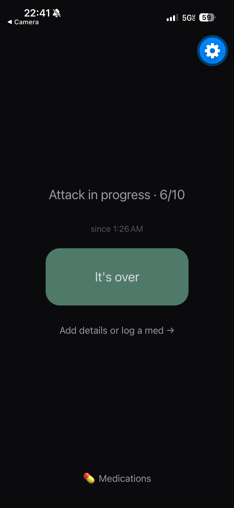
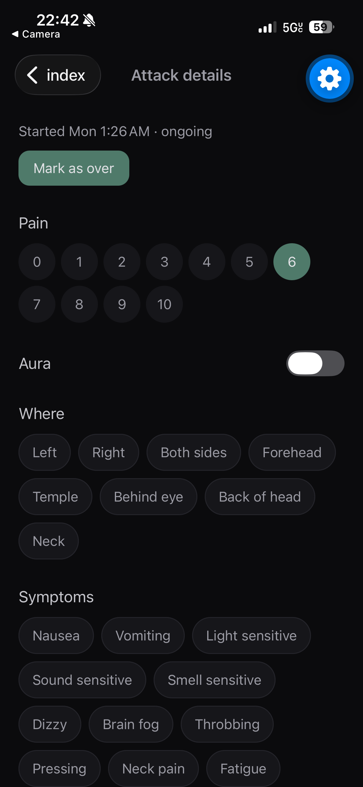
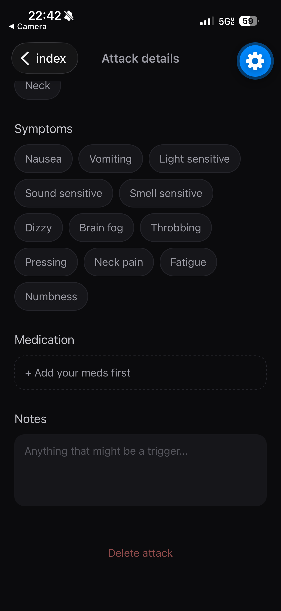
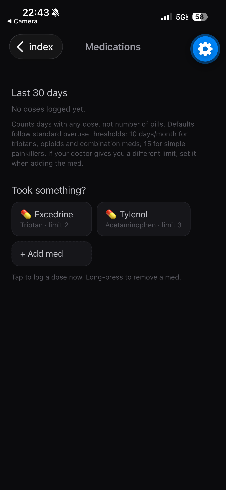

# 🧠 Migraine Log

**A private, local-first migraine tracker built for logging mid-attack.**

I get frequent migraines myself, and most tracking apps felt cluttered or too slow to use when looking at a screen actually hurts. Migraine Log is designed around that moment: dark UI, one tap to start logging, details filled in later. It also watches for medication overuse, a common and easy-to-miss cause of worsening headaches.

<p align="center">
  
  
  
  
</p>

---

## ✨ Features

- **One-tap quick log**: a dark home screen that starts an attack log with a single tap
- **Attack details**: pain scale 0–10, aura, pain location and symptom chips, and notes that autosave
- **Medication logging**: log doses during an attack and rate whether each one helped
- **Medication overuse tracking**: counts treatment *days* per medication class over a rolling 30 days, with thresholds based on common clinical guidance (10/month for triptans, opioids and combination meds; 15/month for simple painkillers; plus a combined total) and per-medication custom limits
- **Overuse alerts**: a banner and a one-time alert when a dose moves you into "getting close" or "overuse range"
- **Private by default**: everything is stored locally on the device in SQLite. No accounts, no cloud

## 🛠 Tech Stack

| Layer | Tools |
|---|---|
| Framework | React Native + Expo |
| Language | TypeScript |
| Navigation | Expo Router (file-based routing) |
| Storage | expo-sqlite with versioned schema migrations |
| Extras | expo-haptics for tactile feedback |
| Builds & release | EAS Build / EAS Submit |

## 📁 Project Structure

```
app/
  index.tsx          # Quick log home screen + overuse banner
  attack/[id].tsx    # Attack detail screen
  meds.tsx           # Medication list, dose logging, 30-day overuse meters
src/
  db/schema.ts       # SQLite schema + versioned migrations
  db/attacks.ts      # Attack data access
  db/meds.ts         # Medication data + overuse logic
  overuseAlert.ts    # Threshold-crossing alerts
  components/        # Chips, OveruseBanner
```

## 🚀 Getting Started

### Prerequisites
- [Node.js](https://nodejs.org/) (LTS)
- The **Expo Go** app on your phone ([iOS](https://apps.apple.com/app/expo-go/id982107779) / [Android](https://play.google.com/store/apps/details?id=host.exp.exponent))

### Run it locally
```bash
git clone https://github.com/Smjoslin95/migraine-log.git
cd migraine-log
npm install
npx expo install --fix   # pins compatible versions for your Expo SDK
npx expo start           # scan the QR code with Expo Go
```

### Build for the stores
```bash
npm install -g eas-cli
eas login
eas build:configure
npm run build:ios && npm run submit:ios          # App Store Connect / TestFlight
npm run build:android && npm run submit:android  # Google Play Console
```

## 🗺 Roadmap

- [x] Attack detail screen
- [x] Medication tracker + overuse alerts
- [ ] History calendar
- [ ] Health data sync (HealthKit / Health Connect) for sleep + HRV
- [ ] Shift-aware sleep tracking + barometric pressure
- [ ] Doctor-ready PDF export
- [ ] Publish to the App Store and Google Play

## 💡 Why I Built This

Tracking migraines is only useful if it's effortless in the worst moment. Building this meant designing around a real user (me), keeping the UX minimal for light sensitivity, and turning clinical guidance on medication overuse into logic that actually warns you before it becomes a problem. It's also my end-to-end practice in shipping a mobile app: data modeling, migrations, and store builds.

## 👩‍💻 About Me

I'm Sam, a software developer on Maui focused on solutions and implementation engineering.

- Portfolio: [smjoslin95.github.io](https://smjoslin95.github.io)
- LinkedIn: [linkedin.com/in/samanthajoslin95](https://linkedin.com/in/samanthajoslin95)
- GitHub: [@Smjoslin95](https://github.com/Smjoslin95)

---

*Not medical advice. Migraine Log is a personal tracking tool, not a diagnostic device. Talk to your doctor about your medication use.*
